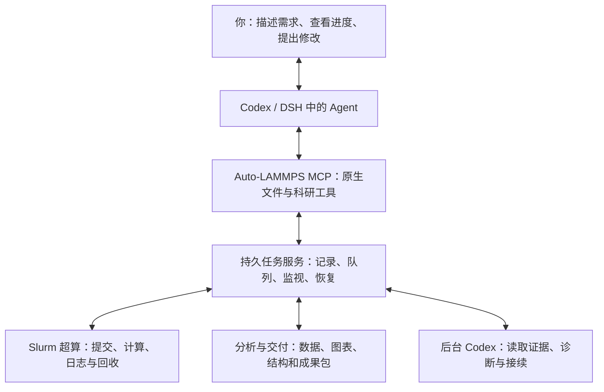

# Auto-LAMMPS MCP v1.0

**在 Codex 或 DeepSeek Harness 中，用自然语言完成材料模拟研究。**

Agent /ˈeɪdʒənt/（智能体）直接编写 LAMMPS、Python 脚本，读取日志并修正；Auto-LAMMPS 负责项目保存、超算执行、后台监视、分析和成果交接。

v1.0 提供[本地记忆、验证复用和批量研究](docs/MEMORY_REUSE.md)：用户可以说“沿用上次方案，再做20次独立重复”。Agent 检索过去工作，已覆盖条件直接准备正式批次，只为变化补充验证。具体安装版本与实测进度见[交付记录](docs/PROGRESS.md)。下面的固定安装提示词继续作为统一入口。

**当前使用环境：macOS · Codex / 官方 DeepSeek Harness（DSH）· Slurm 超算。**

[下载正式版 v1.0](https://github.com/XPYY233/auto-lammps-mcp/releases/tag/v1.0) · Python 包版本 `1.0.0`。Linux 源码与隔离安装通过自动检查；Windows 原生安装仍在后续交付计划中。

[复制安装提示词](#复制给-agent-的安装提示词) · [开始第一项研究](#第一次研究怎么开始) · [查看后台进展](#后台如何继续工作) · [版本与进度](#当前版本与进度) · [文档导航](#文档导航)

## 从这里开始

1. 打开 Codex 或官方 DSH，进入能访问本机文件、执行命令的工作对话。
2. 复制下方**完整安装提示词**，粘贴到对话中。Agent 会读取[给 Agent 的安装指南](docs/FOR_AGENTS_INSTALL.md)，识别环境并推进安装。
3. 按引导选择研究目录、已有超算连接和计算环境。安装完成后，选择新建研究、继续项目或分析结果。

安装会复用平台已有的模型设置。新电脑先登录所选 Agent 平台；需要提交计算时，配置自己的 Slurm 账号、远端工作目录和 LAMMPS 环境。已有结构、势函数或结果目录可以直接提供给 Agent。

## 复制给 Agent 的安装提示词

点击下面代码块右上角的复制按钮。这是项目固定安装提示词；后续会话继续使用同一个入口。

```text
请帮我安装和配置 Auto-LAMMPS，让我可以直接在当前对话中提出材料模拟需求，由你调用软件完成计算、监视、分析和结果展示。

项目仓库：https://github.com/XPYY233/auto-lammps-mcp

请先读取仓库首页指向的“给 Agent 的安装指南”，按发布版本对应的说明完成以下工作。

1. 判断当前环境
识别操作系统、当前 Agent 平台，以及你是否能够执行本机命令、安装插件和调用 MCP。
能安装插件时，优先安装包含工作指南和工具配置的插件。
有本机执行能力时，完成本地安装。已经接入服务时，先检查已有连接。
需要我切换会话或操作平台设置时，告诉我具体打开哪里、填写什么，并保存接续信息。

2. 检查已有安装
检查软件版本、真实安装位置、后台服务和平台连接。
区分尚未安装、命令路径未生效、版本需要更新和执行权限不足，分别处理。
复用已有可用安装，保留研究数据和其他软件配置。

3. 完成安装与平台接入
安装当前发布版本、科研工作指南、命令行、MCP 连接和持久后台。
使用安装器返回的真实路径继续工作。
安装后运行环境检查，并从当前 Agent 会话实际调用软件工具，确认我已经可以在这里使用它。

4. 引导我完成基本配置
先发现已有配置，再集中询问仍然缺少的内容：研究项目保存位置；超算连接、账号和计算队列；远端工作目录和已有 LAMMPS 环境；任务资源设置；后台自动接续和通知偏好。
提供推荐值，并用简短中文解释用途。已有配置让我直接选择；密码、密钥和验证码通过本机凭据入口或登录窗口填写。

5. 验证后台与恢复
检查后台服务、任务保存、通知和后台 Codex 接续能力。
保存配置进度，让我关闭对话后能够继续。
需要重新打开会话时，给我一句可以直接复制的接续提示词。

6. 带我完成第一次使用
配置完成后展示实际配置摘要，让我选择：新建研究、继续已有项目、分析已有结果。
如果我选择首次计算验证，先展示计算内容和资源设置。我说“开始”后，完成提交、进度反馈、数据回收、图表和结果文件。

7. 出错时继续处理
根据当前版本的帮助和检查结果定位问题。
告诉我已经完成什么、卡在哪里、下一步是什么。
保留有效配置和已有成果，从失败处恢复。

整个过程使用简短中文。每完成一个阶段告诉我结果；需要我操作时，一次只给当前必需的步骤。
完成后告诉我如何开始任务、查看进度、暂停或停止、查看结果，以及换一个对话继续研究。
```

安装后，Agent 应分别告诉你：**实际软件版本、当前对话连接、研究目录、超算连接、计算环境、后台接续状态，以及下一步。** 连接核验会在当前对话中真实调用工具。

安装中断时，在新对话里说：

> 继续配置 Auto-LAMMPS，从上次已经完成的步骤接着做。

## 第一次研究怎么开始

| 你的起点 | 可以直接对 Agent 说 |
|---|---|
| 新建研究 | “建立一个 Ni 晶体，在 500 K 下平衡，再进行动力学计算。给我温度、体积、总能、逐原子势能和轨迹。先列出方案与资源。” |
| 继续已有项目 | “导入我选中的项目目录，检查结构、势函数、辅助脚本和运行环境，告诉我接下来能做什么。” |
| 分析已有结果 | “分析这个目录里的 LAMMPS 日志和轨迹，画出温度、能量随时间的变化，并展示对应结构。” |

Agent 会整理研究目标、固定条件和成果清单，先查已有资源，再编写原生脚本。首次计算会展示实际内容和资源设置；你说“开始”后提交到超算。

研究过程中，你可以继续这样操作：

| 想做什么 | 对话示例 | 应看到什么 |
|---|---|---|
| 查看进度 | “现在到哪一步了？” | 当前阶段、最近证据时间、已完成内容和下一步 |
| 修改方案 | “保留加载方向，再增加两个温度。” | 方案差异、新增计算与受影响成果 |
| 排查异常 | “这一组为什么没有进展？” | 日志依据、最后确认状态与恢复动作 |
| 暂停派发 | “暂停后续计算。” | 新派发已停止；现有作业的实际状态 |
| 停止一组 | “停止 600 K 这一组，其他继续。” | 选中的任务与取消回执 |
| 看图与结构 | “展示应力突降前后的曲线和结构。” | 对应时间点、图表、结构或轨迹文件入口 |
| 追加分析 | “更换拟合区间，保留原结果。” | 复用数据的新分析版本与比较 |
| 导出交接 | “导出给同门继续使用。” | 数据、脚本、图表、轨迹、报告与研究记录 |

结果通过当前平台的文件预览以及 OVITO 等科研工具打开。原生脚本、结构和数据保存在普通目录中，可以继续编辑和分析。[完整用户指南 →](docs/USER_GUIDE.md)

## 后台如何继续工作



后台保存任务进度，按集群合并查询作业，跟进日志和输出变化。需要判断时启动后台 Codex，已经确定的上传、回收、分析和导出由队列推进。

- **关闭聊天：** 电脑在线且后台服务运行时，任务继续监视与处理；重要阶段、异常和需要决定的事项通过已配置的通知提醒。
- **电脑休眠或断网：** 已提交的远端作业继续；本机恢复后先核对实际状态，再接续工作。
- **暂时不自动处理：** 说“这项研究先由当前对话处理，暂停后续后台自动接续”。
- **回到项目：** 说“查看未读进展”，或使用下面的接续句。

进展会围绕以下内容展示：

> 任务名称｜已完成内容｜当前阶段｜最近证据时间｜下一步｜需要决定的事项

在同一台电脑的新 Codex 或 DSH 对话中说：

> 使用 Auto-LAMMPS，继续我最近的 Ni 研究，先告诉我完成了什么、现在到哪里、还有什么没交付。

跨电脑时，先在新电脑使用上面的固定提示词完成安装，再导入研究成果包；完整环境迁移使用[备份与恢复流程](docs/RECOVERY.md#升级与恢复)。[后台工作与恢复说明 →](docs/RECOVERY.md)

## 复用已有资源与官方命令说明

已有势函数、作者项目、脚本和已验证运行环境可以登记到研究资源库。Agent 先按材料与计算方法查找，再核对来源、版本、元素映射和实际文件。

> 接入我已有的资源库，先找 Ni 势函数和对应的 LAMMPS 代码用法，核对已有文件后复用。

软件提供按引擎版本读取、缓存官方命令说明的工具。脚本生成与修正时可读取命令格式、示例和限制；提交准备会检查输入快照中的已知错误。资源检索会区分已有文件和待获取的索引条目。[资源与命令使用方法 →](docs/USER_GUIDE.md#使用已有资源库)

## 当前版本与进度

| 入口 | 当前内容 |
|---|---|
| [正式版 v1.0](https://github.com/XPYY233/auto-lammps-mcp/releases/tag/v1.0) | Python 包 `1.0.0`；MCP/CLI、持久任务、资源与官方语法、本地记忆、验证复用、批次执行、分析版本和成果交接 |
| P0–P4 开发与阶段检查 | 功能开发完成；阶段证据见[交付记录](docs/PROGRESS.md) |
| Ni 开发流程 | 已完成 256 原子、500 K 平衡 5 ps、NVE 10 ps；交付五张图、11 帧轨迹、报告与完整研究包，保留三次失败和后续成功记录 |
| 当前整体验收 | 官方 DSH 正在完成 NbTiZrMoV 新研究的完整应用流程；独立安装、真实批次、四类研究矩阵、故障恢复和七天监视继续按计划推进 |

固定安装提示词默认选择正式发布包；Agent 使用同一发布标签下的指南、skill 和安装器。版本变更见[发布说明](docs/RELEASE_V1.md)，实测记录见[交付进度](docs/PROGRESS.md)、[验证记录](docs/VALIDATION.md)与[验收指标](docs/ACCEPTANCE.md)。

## 手动安装与维护

<details>
<summary>从发布标签安装（Codex / DSH）</summary>

准备可用的 Git 与 Python。安装器优先通过 uv 创建 Python 3.13 环境；不使用 uv 时，需要 Python 3.12 或更新版本。

在一个新的代码目录中获取固定发布版本：

```sh
git clone https://github.com/XPYY233/auto-lammps-mcp.git
cd auto-lammps-mcp
git checkout --detach v1.0
```

接入 Codex：

```sh
python3 scripts/install.py --source . --host codex
```

接入官方 DSH，把示例路径替换为自己的 Harness 安装目录或 dsh 程序路径：

```sh
python3 scripts/install.py --source . --host dsh \
  --dsh-runtime /absolute/path/to/deepseek-harness --dsh-profile web
```

安装器返回实际命令路径、平台配置、已完成步骤和接续入口。按回执重新加载对话中的工具，然后让 Agent 调用 MCP `doctor` 与 `task_list`，核对当前连接和原任务。

发布页同时提供 wheel、安装器和校验摘要，详见[给 Agent 的安装指南](docs/FOR_AGENTS_INSTALL.md)。

</details>

**更新与回退：** 让 Agent 读取已有安装回执，选择固定版本并保留研究数据；需要回退时恢复上一个版本并核对原任务。[操作说明 →](docs/RECOVERY.md#升级与恢复)

**备份与迁移：** 保存数据库、项目、快照及交接记录；新电脑恢复后先核对原作业，再接续执行。[操作说明 →](docs/RECOVERY.md#升级与恢复)

**卸载：** 停止本项目后台、移除本项目 MCP 连接和 skill，再选择保留或迁移研究目录。[操作说明 →](docs/RECOVERY.md#升级与恢复)

## 文档导航

| 你需要什么 | 入口 |
|---|---|
| 让 Agent 安装和配置 | [给 Agent 的安装指南](docs/FOR_AGENTS_INSTALL.md) |
| 每一步怎样提需求、看结果 | [用户指南](docs/USER_GUIDE.md) |
| 关闭聊天、恢复失败、备份迁移 | [后台与恢复](docs/RECOVERY.md) |
| 查看当前完成情况和证据 | [交付进度](docs/PROGRESS.md) · [验证记录](docs/VALIDATION.md) |
| 查看完整产品目标与验收 | [批准计划](docs/APPROVED_PLAN.md) · [验收指标](docs/ACCEPTANCE.md) |
| 理解模块和扩展接口 | [开发说明](docs/DEVELOPMENT.md) · [资源来源](docs/ASSET_PROVENANCE.md) |
| 阅读开发与交付手册 | [发布版 PDF](https://github.com/XPYY233/auto-lammps-mcp/releases/download/v1.0/Auto-LAMMPS-MCP-handbook.pdf) · [可编辑源稿](https://github.com/XPYY233/auto-lammps-mcp/releases/download/v1.0/Auto-LAMMPS-MCP-handbook.tex) |
| 下载版本或反馈问题 | [Releases](https://github.com/XPYY233/auto-lammps-mcp/releases) · [Issues](https://github.com/XPYY233/auto-lammps-mcp/issues) |

## 参与开发

从明确的用户任务开始，通过 Issue、独立分支、PR 和自动检查完成修改。MCP 与 `alm call` 连接同一任务服务；`alm help` 提供当前版本的工具参数。

```sh
uv venv --python 3.13
uv pip install -r requirements.lock.txt
uv pip install -e .
.venv/bin/pytest -q
.venv/bin/python scripts/check_public_tree.py
.venv/bin/python scripts/render_review_traceability.py --check
```

项目采用 [Apache-2.0](LICENSE)。第三方资源按各自来源和许可使用，参见[资产来源记录](docs/ASSET_PROVENANCE.md)。
