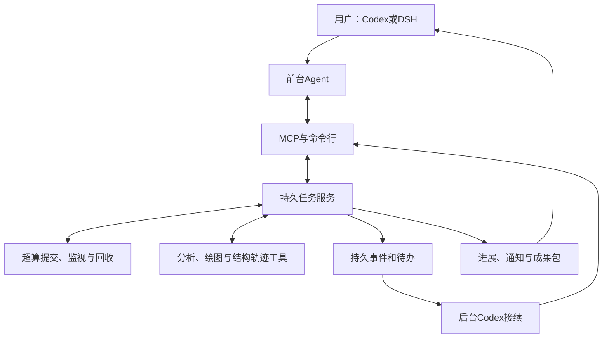

# Auto-LAMMPS MCP 重构完整计划
**2026年10月26日｜四轮审核、v1失败复盘与DeepCell式安装引导整合版**

本计划统一此前的重构方案、审核意见、[v1完整失败复盘](REFERENCE_SOURCES.md#v1)，以及用户通过现有Agent平台安装和使用软件的具体流程，替代前面的分散版本。

**产品目标：用户在Codex、DSH中描述科研需求，Agent /ˈeɪdʒənt/ 直接编写科研脚本、调用工具、根据反馈修正；软件负责可靠执行、持久保存、持续监视、分析可视化和成果交接。**

新公开仓库采用 `XPYY233/auto-lammps-mcp`。首版支持macOS、Codex、DSH与现有Slurm集群，后台接续使用Codex。交互使用现有对话平台，结果使用平台预览和成熟科研查看工具，不开发独立前端。

## 一、产品方向与失败修正

### 1. 软件必须增加的能力

用户可以从研究想法、已有脚本、运行中的任务或已有结果进入。软件持续维护同一个研究项目，使用户能够：

- 直接表达科学目标，调用原生LAMMPS、Python和成熟分析工具。
- 导入完整项目，包括结构、势函数、辅助程序、环境和已有结果。
- 在关闭聊天后继续运行、监视，并在需要判断时启动后台Agent。
- 根据日志修正错误，保留每次修改、提交、成本和失败。
- 查看图表、原子结构和轨迹，继续提出分析需求。
- 换对话、换平台后接续同一个任务。
- 导出同门能够理解、打开和继续分析的成果包。

### 2. 复盘结论转成实现要求

| v1暴露的问题 | 新版实现要求 | 必须通过的验证 |
|---|---|---|
| 同一事实在方案、脚本和分析描述中重复填写 | 原生文件承担科研内容；文件位置、摘要、列数等由程序读取 | 局部修改保留正确内容，关联信息同步更新 |
| 50份方案因合法体积单位被拒绝 | 支持量纲和单位换算，保留原始表达 | 原失败输入能正确处理立方埃及相关分析 |
| 17次运行重复出现温度读取错误 | 正确采样方法进入工具说明、生成前检索和回归检查 | 原错误可以重现，修正方法在计算节点得到验证 |
| 公共启动环境导致连续失败 | 保存经过实际验证的引擎、依赖与启动方式 | 干净批处理环境能够启动、计算并输出 |
| 方案次数耗尽后诊断被阻止 | 诊断、文件修改、分析重做和计算提交分别计数 | 提交次数用尽后仍能诊断并整理已有成果 |
| 用户规则变化没有进入执行端 | 每个任务保存适用规则、来源和起效范围 | 提交回执与用户确认的规则一致 |
| 凭据更新后旧作业失联 | 作业身份与连接凭据分开维护 | 换凭据后能查询原作业，保留原历史 |
| 作业结束却遗漏用户要求 | 原始需求贯穿规划、执行、分析和完成检查 | 必需成果缺失时继续处理对应缺项 |
| 局部测试通过，实际安装版本仍失败 | 同一发布版本完成完整用户流程 | 源码、安装包、后台、skill与验收记录一致 |
| 对照实验的工具和环境不一致 | 分开比较执行服务与Agent规划能力 | 模型、资源、交互方式、迭代规则和分母可核对 |

四轮审核意见和九视角的45条原始意见逐项关联实现任务与验证结果。

### 3. 借鉴DeepCell的产品方式

依据[用户提供的DeepCell说明](REFERENCE_SOURCES.md#deepcell)，采用以下设计：

- 仓库首页提供一段完整安装提示词，以及“给Agent的安装指南”。
- 插件同时携带工具连接和工作方法。
- Agent先识别环境，再选择安装或接入路径。
- 环境检查返回实际状态、已完成动作和下一步。
- 帮助、规则、合法参数和示例随软件版本发布。
- 命令行与MCP连接同一个任务服务。
- 执行后读取真实产物核对结果。
- 输入变化能够追踪受影响的数据、图表和结论。
- 项目可以接续、迁移和交接。

科研脚本保持原生、可直接编辑，项目记录维护文件之间的关系。

## 二、从安装提示词到第一次研究

### 1. 用户的第一步

用户打开Codex或DSH，进入能够访问本机文件和执行工具的工作对话，粘贴安装提示词。

安装过程由Agent推进。用户主要承担三类操作：选择自己的连接与目录、完成身份登录、确认首次计算的内容和资源。

首个发布版本在仓库首页提供以下完整提示词：

```text
请帮我安装和配置 Auto-LAMMPS，让我可以直接在当前对话中提出材料模拟需求，由你调用软件完成计算、监视、分析和结果展示。

项目仓库：https://github.com/XPYY233/auto-lammps-mcp

请先读取仓库首页指向的“给Agent的安装指南”，按发布版本对应的说明完成以下工作。

1. 判断当前环境
识别操作系统、当前Agent平台，以及你是否能够执行本机命令、安装插件和调用MCP。
能安装插件时，优先安装包含工作指南和工具配置的插件。
有本机执行能力时，完成本地安装。
已经接入服务时，先检查已有连接。
需要我切换会话或操作平台设置时，告诉我具体打开哪里、填写什么，并保存接续信息。

2. 检查已有安装
检查软件版本、真实安装位置、后台服务和平台连接。
区分尚未安装、命令路径未生效、版本需要更新和执行权限不足，分别处理。
复用已有可用安装，保留研究数据和其他软件配置。

3. 完成安装与平台接入
安装当前发布版本、科研工作指南、命令行、MCP连接和持久后台。
使用安装器返回的真实路径继续工作。
安装后运行环境检查，并从当前Agent会话实际调用软件工具，确认我已经可以在这里使用它。

4. 引导我完成基本配置
先发现已有配置，再集中询问仍然缺少的内容：
研究项目保存位置；
超算连接、账号和计算队列；
远端工作目录和已有LAMMPS环境；
任务资源设置；
后台自动接续和通知偏好。
提供推荐值，并用简短中文解释用途。
已有配置让我直接选择；密码、密钥和验证码通过本机凭据入口或登录窗口填写。

5. 验证后台与恢复
检查后台服务、任务保存、通知和后台Codex接续能力。
保存配置进度，让我关闭对话后能够继续。
需要重新打开会话时，给我一句可以直接复制的接续提示词。

6. 带我完成第一次使用
配置完成后展示实际配置摘要，让我选择：
新建研究、继续已有项目、分析已有结果。
如果我选择首次计算验证，先展示计算内容和资源设置。
我说“开始”后，完成提交、进度反馈、数据回收、图表和结果文件。

7. 出错时继续处理
根据当前版本的帮助和检查结果定位问题。
告诉我已经完成什么、卡在哪里、下一步是什么。
保留有效配置和已有成果，从失败处恢复。

整个过程使用简短中文。
每完成一个阶段告诉我结果；需要我操作时，一次只给当前必需的步骤。
完成后告诉我如何开始任务、查看进度、暂停或停止、查看结果，以及换一个对话继续研究。
```

### 2. 安装器承担的工作

安装器提供可重复执行、可中断恢复的流程：

1. 检查平台能力、已有安装、实际路径和版本。
2. 安装对应发布版本及必要依赖。
3. 配置当前平台的工具连接和工作指南。
4. 启动独立后台服务。
5. 检查当前会话能否发现并调用工具。
6. 保存基础配置，验证连接和研究目录。
7. 检查后台Agent执行器及登录状态。
8. 生成安装回执和接续入口。

安装过程保存独立进度。重复执行复用已完成步骤；命令路径没有刷新时使用实际安装路径；权限问题通过平台正常授权入口处理。

安装回执分别记录：

- 软件和版本是否可用。
- 当前对话是否能调用工具。
- 集群连接是否可用。
- 运行环境是否完成验证。
- 后台服务和Agent接续是否可用。
- 当前还需要用户完成什么。

只有MCP访问能力时，检查已部署连接；需要安装本机服务时，引导用户切换到具备本机工具的工作对话，并保留安装进度。

### 3. 基础配置怎样询问

| 配置内容 | Agent自动完成 | 用户提供或选择 |
|---|---|---|
| 本地研究目录 | 检查当前目录与已有项目 | 选择已有目录或创建专用目录 |
| 超算连接 | 查找可用连接名称和配置 | 选择连接；缺少时提供地址与用户名 |
| 身份认证 | 发起登录或凭据配置流程 | 在对应入口完成认证 |
| 队列与工作目录 | 读取可用队列、目录权限和已有设置 | 选择所属项目或队列 |
| 计算环境 | 查找已有引擎、依赖与势函数资源 | 处理确实无法自动取得的信息 |
| 模型 | 检查前台平台配置与后台Codex登录 | 完成所需登录，确认使用配置 |
| 资源与通知 | 给出可用配置和推荐方式 | 确认任务资源与通知偏好 |

前台沿用Codex或DSH的既有模型连接。后台Codex独立检查能否执行接续任务。凭据通过系统或平台现有入口管理。

Codex和DSH分别使用其实际支持的接入方式；首次安装后必须在平台内完成真实工具调用。[Codex接入说明](https://developers.openai.com/learn/docs-mcp)、[DSH接入说明](https://github.com/deepseek-ai/deepseek-harness/blob/master/packages/mcp/mcp-client/README.md)。

### 4. 第一次完整使用

首次引导提供三个选择：

- **新建研究：** 用户直接描述目标。
- **继续已有项目：** 用户提供本机目录或已登记的远端项目。
- **分析已有结果：** 用户提供结果文件或选择历史任务。

首次计算验证使用资源完整的Ni任务，覆盖温度、体积、总能、逐原子势能与轨迹。Agent先展示计算内容、资源设置和预期成果，用户说“开始”后执行。

安装与首次使用共同构成第一个产品交付目标。

## 三、用户在Agent界面中的完整操作

### 1. 从需求到结果

| 用户在界面中的操作 | Agent与软件的响应 |
|---|---|
| 新建对话，输入“比较完整晶体与含空位晶体的拉伸响应，给我曲线和结构演化” | 保存原话，整理目标、固定条件、方法和成果要求 |
| 提供结构、势函数或项目目录 | 读取完整项目，核对资源、依赖、元素映射和版本 |
| 输入“保持加载方向，增加两个温度和独立重复” | 展示方案变化、新增工作与受影响成果 |
| 输入“按这个方案开始，后续自动处理” | 固定输入与规则，保存执行意图，提交并返回实际记录 |
| 输入“现在到哪一步了” | 读取最新状态、阶段、输出变化及证据时间 |
| 输入“这一组为什么没有进展” | 检查日志、资源使用和输出更新时间，给出证据与处理动作 |
| 输入“暂停后续计算” | 停止新的派发，说明当前作业是否仍在运行 |
| 输入“停止这一组，其他继续” | 定位分组，取消对应作业并阻止后续派发 |
| 输入“展示应力突降前后的结构” | 对齐曲线与轨迹，展示结构预览和分析 |
| 点击图表或文件链接 | 在平台预览或成熟工具中打开成果 |
| 输入“重新选择拟合区间，保留原结果” | 复用数据，生成新的分析版本与比较 |
| 输入“导出给同门继续使用” | 生成完整研究结果包 |

影响科学目标或固定条件的歧义集中澄清。常规文件操作、数据回收和已授权范围内的技术处理由Agent完成。

多个任务名称相近时，展示材料、创建时间和当前阶段供用户选择，随后所有操作绑定明确任务。

### 2. 用户怎样监视后台

开始执行后，对话中显示：

> **任务名称｜已完成内容｜当前阶段｜最近证据时间｜下一步｜需要用户决定的事项**

监视分为三种使用方式：

- 对话持续进行时，Agent读取进展并反馈阶段变化。
- 用户退出平台后，后台继续保存进展，重要变化通过桌面通知提醒。
- 用户回来后，输入“查看未读进展”或“继续最近的Ni任务”，读取离开期间的事件和当前状态。

后台定期更新项目记录。阶段完成、异常、需要决策和最终交付触发通知；普通重复查询合并处理。

### 3. 换对话、换平台怎样继续

用户在新的Codex或DSH对话中输入：

> 使用Auto-LAMMPS，继续我最近的Ni研究，先告诉我完成了什么、现在到哪里、还有什么没交付。

Agent查找同一个任务，恢复原始需求、固定条件、执行记录、成果和待办。跨平台接续使用同一本机任务服务。

安装中断也采用相同方式：

> 继续配置Auto-LAMMPS，从上次已经完成的步骤接着做。

### 4. 最终交付怎样呈现

对话中先展示：

1. 回答研究问题的主要结论。
2. 带单位、图例和方法说明的关键图表。
3. 对应结构和轨迹预览。
4. 数据、脚本、图表、轨迹与报告的文件入口。
5. 可以继续提出的分析操作。

图表可以追到原始数据和分析方法。用户可以指定其他工况、时间点、样本、统计区间和展示方式。

## 四、实现结构、后台与恢复

### 1. 系统分工



实现采用现有Python技术基础：

- 持久任务服务负责研究状态、规则、执行意图和成果关系。
- 事务数据库保存任务、事件和待办队列。
- 普通目录保存原生脚本、输入和结果。
- 执行监视器处理提交、查询、回收和核算。
- 分析工作进程负责统计、绘图和结构处理。
- 后台接续器在需要判断时启动Codex。
- macOS系统服务负责启动和恢复后台进程。

本地MCP桥接和命令行连接同一后台。聊天平台退出后，后台继续运行。

### 2. 公共接口

| 接口组 | 必备能力 |
|---|---|
| 安装与环境 | 检查安装状态、保存配置进度、检查连接、查询帮助与下一步 |
| 任务 | 创建、查找、读取、修改需求、接续、暂停、恢复和停止 |
| 项目文件 | 导入目录、完整读取、局部修改、建立快照、查看差异 |
| 资源 | 查询结构、势函数、作者项目、文献证据和运行环境 |
| 执行 | 准备、提交、查询、读取日志、取消、回收和核算 |
| 分析与成果 | 执行分析、检查结果、生成预览、追踪来源和导出 |

所有变更操作绑定任务版本和操作编号。耗时操作先返回持久编号，随后读取进度。长日志支持分段读取，并返回读取范围、截断状态和后续入口。

错误反馈明确说明：执行前拒绝、已保存待修正、部分完成或状态未知，以及对应恢复动作。

### 3. 一个研究项目保存什么

每个项目持续保存：

- 用户原话、固定条件、交付要求和后续变更。
- 当前方案、科学选择及理由、阶段关系和剩余事项。
- 结构、势函数、脚本、环境、元素映射和随机种子。
- 工况、独立样本、续算、重试和分析版本。
- 作业身份、状态、输出、费用、失败与诊断。
- 图表、原始数据、分析方法和结论之间的关系。
- 当前执行者、操作权、适用规则和下一步。

聊天提供交流上下文，任务服务保存执行事实。

### 4. 保留原生脚本能力

Agent直接编写和修改科研文件。新增分析方法通过Python及成熟工具实现。

程序负责维护真实文件位置、摘要、大小、版本和实际输出。避免要求模型重复填写程序能够推导的事实。

文件修改采用局部更新，保存差异。上游输入变化后，自动标记受影响的计算和分析；Agent重新检查相关结论。未受影响的成果继续复用。

完整项目导入保留目录关系、辅助程序、相对引用、二进制模型和自定义环境。

### 5. 执行规则与环境

普通研究、作者参考、独立评测和历史实验分别维护规则。规则包含来源、适用范围、资源设置、提交次数及起效时间。

普通研究按本任务授权迭代；正式B保留其两次提交要求。诊断、读取和已有数据分析与重新计算分别推进。

每次提交保存实际生效规则和输入快照。用户停止任务后，先保存停止意图，再取消当前作业并阻止后续派发。

运行环境记录引擎、依赖、启动方式及计算节点验证结果。运行中的任务继续绑定原环境；升级为新任务启用新版本。

所有物理求值经记账HPC执行；轻量统计和绘图本地处理，大轨迹就近处理。集群现有软件、势函数和已验证环境优先复用。

### 6. 类Harness监视与自动接续

Harness /ˈhɑːrnɪs/ 承担持续观察、反馈和接续：

1. 常规程序读取调度状态、计算阶段、输出变化和资源使用。
2. 阶段完成、失败、需求变更和成果缺项形成持久事件。
3. 已确定的回收和分析进入队列。
4. 需要判断的事件唤起后台Codex。
5. Agent读取任务与证据，完成诊断、修正或后续研究。
6. 服务核对新产物，更新状态并通知用户。

同一任务同时只有一个执行者推进关键动作。操作权过期后，新执行者可以接手；过期执行者的写入被拒绝。前台新要求通过任务版本与操作权交接生效。

默认反馈要求：

- 运行任务每60秒合并查询，同一集群复用查询结果。
- 连续两次查询失败，展示连接异常、最后确认状态和时间。
- 活跃操作每60秒内更新状态。
- 长任务每5分钟更新可读摘要。
- 阶段完成、异常、需要决策和最终交付触发通知。
- 科学进度根据步数、物理时间和输出变化表达。

电脑在线时，退出聊天平台后后台继续执行。休眠或断网期间，已提交远端作业继续；本地恢复后核对并接续。模型暂不可用时，保存待判断事项，继续已确定的工作。

### 7. 恢复与防重复

- 一个执行意图对应一次派发，重复调用返回原记录。
- 提交回执丢失时先寻找原作业，再决定下一步。
- 凭据更新后，使用原作业身份继续查询和核算。
- 上传和回收中断从已验证位置恢复。
- 分析失败保留计算结果，只重做受影响分析。
- 服务重启先核对已派发动作，再推进队列。
- 脚本修改形成新版本，失败记录和原始费用始终保留。
- 科学异常与程序故障分别判断，固定科学条件的变更明确呈现给用户。

## 五、实施顺序、验收与交付

### 1. 第一项完整交付

第一项交付使用资源完整的Ni研究，沿用已有明确工况，覆盖平衡、后续动力学、温度、体积、总能、逐原子势能和轨迹。

全过程为：

> 复制安装提示词 → 安装接入 → 基础配置 → 自然语言需求 → 读取资源 → 原生脚本 → 真实计算 → 故障诊断与恢复 → 图表和结构预览 → 追加分析 → 换对话接续 → 导出交接。

先通过开发验证，再由独立使用者根据公开说明完成新任务。需要开发者补目录、修改数据库、代做分析或手工接续的地方，继续作为产品问题处理。

**第一条完整流程通过后，才扩展研究领域和任务数量。**

### 2. 五个开发里程碑

| 阶段 | 主要工作 | 完成条件 |
|---|---|---|
| 1．建立项目与安装入口 | 创建公开仓库，登记审核与复盘要求，核定资产，完成安装提示词、指南、安装器、平台配置和规则记录 | 用户能由提示词完成接入；当前会话实际调用工具 |
| 2．贯通Ni完整研究 | 原生文件、提交、后台、恢复、分析、展示、接续和交接 | 独立用户完成一项新研究和一次恢复 |
| 3．逐类扩展 | 双平台完整使用，四类研究，文献与既有项目接入 | 每类研究均能交付完整成果 |
| 4．验证可靠性与增益 | 保留任务、故障、科学反例、配对比较、七天监视 | 达到发布指标，关闭共同故障和流程阻断 |
| 5．固定版本交付 | 干净安装、升级回退、备份恢复、文档和安装包核验 | 同一版本可安装、运行、恢复和交接 |

### 3. 发布指标

完整研究完成要求：用户必需成果齐全、科学检查通过、文件可打开、来源可追溯，并能够继续分析。

| 指标 | 发布要求 |
|---|---|
| 安装与首次使用 | 从复制提示词到完成首项研究，开发者补步骤为零 |
| 目标保真 | 每项原始要求都有对应成果，错误宣告完成为零 |
| 完整研究 | 24项至少完成22项，四类研究各至少完成5/6 |
| 新任务能力 | 其中12项不参与开发调试，至少完成11项 |
| 故障恢复 | 12类故障各验证3次，36次全部达到预定恢复结果 |
| 科学错误识别 | 八类反例全部识别，提供证据与正确处置 |
| 操作反馈 | 本地接收回执95%在2秒内返回，持续反馈达到约定频率 |
| 持久后台 | 连续7天监视，通过退出平台、重启、断线和接续检查 |
| 双平台 | Codex、DSH均完成创建、执行、监视、控制、分析和导出 |
| 产品增益 | 同模型比较完成率不下降，人工操作中位数减少30%，恢复时间中位数减少50% |
| 版本交付 | 源码、安装包、后台、skill、文档与验收记录对应同一版本 |

基线人工操作为零时，新版保持零。记录总耗时、排队、模型调用、计算成本和维护投入。

四类研究为：

| 领域 | 科学检查重点 |
|---|---|
| 缺陷与辐照 | 参考晶格、初始与新增缺陷、独立样本、物理时间与事件轨迹 |
| 界面与力学 | 几何、取向、边界、加载方式、应力应变定义与结构对应 |
| 输运 | 位移定义、统计窗口、相关采样、独立重复、收敛与不确定度 |
| 机器学习势验证 | 完整项目、模型与数据版本、元素和原子映射、误差归因 |

每类六项覆盖新建、导入、多工况与独立重复、故障恢复、跨对话接续和追加分析。

### 4. 必须执行的测试场景

**安装检查：** 首次安装、已有安装、路径未生效、权限不足、安装中断、会话重载、重复配置、升级回退，以及仅有MCP访问能力的接入引导。

**12类故障：** 连接中断、凭据更新、上传中断、提交回执丢失、调度查询失联、服务重启、Agent中断、模型响应截断、环境失效、引擎报错、分析失败、输出缺失或损坏。

**八类科学反例：** 平均量冒充局域量、参考晶格错误、元素或原子身份错配、工况错挂、重复样本重计、统计窗口错误、采样不足、真实异常被错误修正。

优先使用已有失败输入。每个场景预先规定恢复结果，检查没有重复提交、数据串用或历史丢失。

保留任务由独立评测者管理。开发中使用过的案例转入开发集，并补入新的保留任务。科学容差、采样要求、迭代规则和资源配置在运行前固定。

### 5. 直接Agent与产品的比较

采用两条独立比较路径：

- **同脚本比较：** 同一输入经过直接路径和产品路径，检查环境、传输、提交、恢复及服务开销。
- **同需求比较：** 同模型面对相同需求、资源和计算规则，比较完整交付、人工操作和恢复表现。

对齐模型设置、工具交互能力、上下文、输出长度和迭代规则，平衡执行顺序，各组使用独立上下文。

分别记录计划任务、已开始任务、模型调用、正式提交、正常结束和完整研究完成，每个比例给出明确分母。

### 6. 防止再次陷入局部修补

每个开发任务对应一个用户目标，并附完整流程验证。

首次确认公共环境、模板或工具缺陷后，暂停受影响的新派发。通过最小失败样本、原失败样本和完整研究流程后，再恢复该类批量任务。

同一问题连续两次修复没有新证据，或一小时仍未定位，转入最小复现、共同原因和替代路径分析。

每个里程碑汇报：

> **用户新增完成了什么｜还有什么未交付｜证据在哪里｜下一步是什么**

### 7. 旧资产复用与迁移

| 资产 | 复用方式 |
|---|---|
| 第一周NbTiZrMoV的A/B曲线与轨迹 | 接入结果项目，支持结构演化、重新绘图和追加分析 |
| CoCrNi九温度作者数据 | 继续能量、结构和短程有序分析，复用已完成计算 |
| FeAl已完成状态与1024位点扫描 | 保留原数据，补齐化学势及映射后分析 |
| W空位及已完成MD结果 | 用于导入、尺寸分析、完整性检查和再分析 |
| 作者项目、势函数和现有引擎 | 复用来源、许可、元素映射及已验证环境 |
| 文献工作台 | 复用论文身份、图表、原文位置、条件和导出能力 |
| 提交、记账、上传、回收、核对 | 拆出独立能力，在新版完整任务中验证 |
| 解析、绘图与OVITO处理 | 接入可恢复队列，核验输入、单位和成果 |
| 失败原稿与日志 | 建立版本固定的回归样本和工具经验 |

每项代码复用记录来源版本、许可、必要修改和验证结果。旧数据库通过专用只读入口访问，新版使用独立环境、目录与写入身份。

旧实验保持已停止扩展的状态，原始数据、费用和失败完整保存。

文献复现先提取论文结果确定范围，再运行作者流程与独立生成流程；共享计算只执行一次。参考答案、作者解法与独立评测分别落实文件、工具和网络访问边界。

### 8. 项目skill与开发流程

新版skill随仓库发布，内容集中于：

- 安装、自检和首次配置。
- 理解需求与维护交付清单。
- 原生脚本和成熟工具使用。
- 资源发现与既有成果复用。
- 后台接续、反馈和任务控制。
- 诊断、恢复、科学检查和结果交接。

帮助、参数和示例从当前接口生成。经验包含适用条件、失败证据、正确动作和验证样本，通过验证后进入运行时工具说明。

旧skill增加新旧项目路由，历史界面、模型和实验规则归入对应版本。当前执行规则从任务记录读取。

开发采用Issue、独立分支、PR、自动检查和版本发布。公开检查使用可公开的测试资料；真实研究与计算通过私有验收环境完成。每次修复生成新的发布候选，保留旧版本及其验证结果。

### 9. 最终交付

交付物包括：

- 公开源码仓库与固定版本安装包。
- 完整安装提示词、Agent安装指南和可恢复安装器。
- Codex、DSH接入配置及项目skill。
- MCP与命令行、持久任务服务和后台Codex接续器。
- 资源、执行、分析、可视化与导出能力。
- 用户指南，包含每个阶段的实际操作和自然语言示例。
- 开发说明，包含模块职责、接口、任务记录及扩展方式。
- 后台与恢复手册。
- 科学检查、案例、故障和配对比较的验收记录。
- 资产迁移、安装升级、备份回退和进度交接文档。
- 《项目开发与交付手册》PDF与可编辑源稿。
- 同门能够打开、理解并继续分析的完整研究结果包。

**项目完成条件：独立用户从一段安装提示词开始，在已有Agent平台内完成研究；能够看到进展、控制任务、恢复失败、换对话接续，并拿到可用于下一步研究的成果。**


